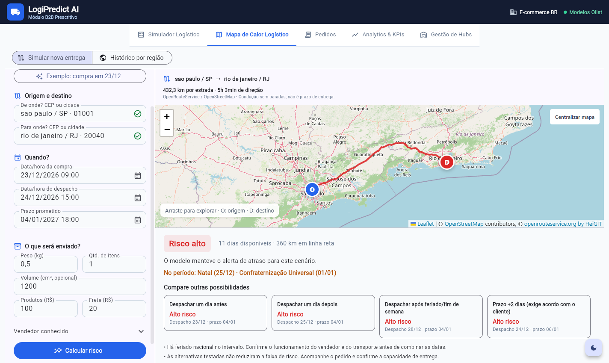
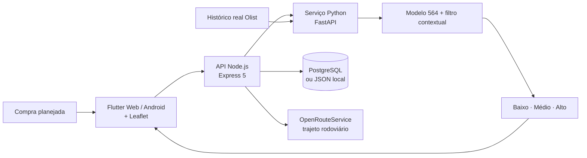
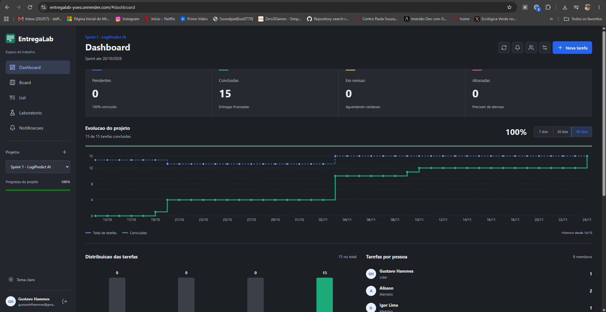
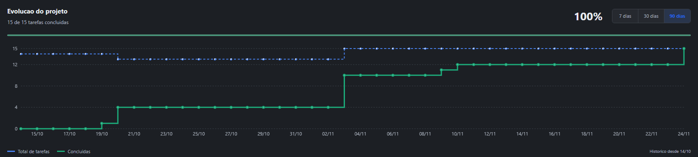

<div align="center">

# 📦 LogiPredict AI

**Previsão de risco de atraso em entregas do e-commerce brasileiro, com dados reais da Olist**

Projeto Integrador · Desenvolvimento de Software Multiplataforma · FATEC Jacareí<br>
**[HallwayTech](https://github.com/hallwaytechgrupo) & [Octacode](https://github.com/octacodeteam)**


[**🚀 Acessar a demonstração online**](https://logipredict-ai-abp.pages.dev)

[Visão geral](#-visão-geral) · [Funcionalidades](#-funcionalidades) · [Como funciona](#-como-funciona) · [Modelos e resultados](#-modelos-e-resultados) · [Executar](#-como-executar) · [API](#-api) · [Documentação](#-documentação) · [Equipe](#-equipe)

</div>

---

## 🎯 Visão geral

O **LogiPredict AI** ajuda a antecipar quais entregas têm maior risco de atrasar **antes do despacho**. Você informa uma compra planejada (origem, destino, datas, prazo prometido e características do pacote) e a plataforma devolve uma classificação de risco **Baixo, Médio ou Alto**, mostra o trajeto por estradas no mapa e compara alternativas de despacho e de prazo.

A previsão é feita por modelos de Machine Learning treinados **offline** com o dataset público da Olist (2016–2018). Ao clicar em **Calcular risco**, o serviço apenas carrega os pesos já treinados e analisa a entrada: nenhum modelo é retreinado e a simulação não vira um pedido salvo.

> ⚠️ **Projeto acadêmico.** Os resultados são retrospectivos e exploratórios. Veja as [limitações](#-limitações-importantes) antes de interpretar qualquer número.

## ✨ Funcionalidades

| Área | O que está disponível |
| --- | --- |
| **Planejamento de entregas** | Simulação de uma compra futura com datas, origem, destino, peso, volume, quantidade e valores |
| **Mapa interativo** | Leaflet com OpenStreetMap, formulário lateral e classificação da entrega |
| **Trajeto rodoviário** | Percurso por estradas (Web e Android), com distância e tempo de direção via OpenRouteService e cache no backend |
| **Histórico regional** | Atrasos observados na base Olist por região e UF, com hubs cadastrados no mapa |
| **Comparação de alternativas** | Novas previsões ao variar a data de despacho ou o prazo, com feriados do intervalo indicados |
| **Operação logística** | Simulador logístico, importação de pedidos por CSV, consulta de pedidos, indicadores e gestão de hubs |
| **Multiplataforma** | Flutter Web e aplicativo Android, com servidor configurável por USB, Wi-Fi ou HTTPS |
| **Nuvem** | Frontend, API, inferência e banco em serviços independentes |

## 🖼️ Demonstração


*Cenário hipotético de compra em 23/12: a classificação vem do modelo preservado e os feriados aparecem como contexto.*



*Percurso por estradas calculado pelo OpenRouteService.*

**Passo a passo**

1. Abra **Mapa de Calor Logístico → Simular nova entrega**.
2. Pesquise origem e destino por **CEP ou cidade** e escolha uma sugestão.
3. Informe compra, despacho, prazo prometido e características da encomenda.
4. Clique em **Calcular risco** para ver a classificação, o trajeto e as alternativas.
5. Quer só conhecer o fluxo? Use **Exemplo: compra em 23/12** e altere os campos.

Os locais vêm de um catálogo real de **19.011 prefixos de CEP** (coordenadas aproximadas) e o catálogo também preserva **3.095 vendedores reais**. O ID do vendedor é opcional: sem ele, a análise usa o contexto de rota e região, sem atribuir ao pedido o histórico de outro vendedor. Mais detalhes no [guia do mapa e da demonstração](docs/mapa-e-demonstracao.md).

## 🧠 Como funciona



A classificação reflete as duas etapas de decisão do modelo:

| Faixa | Interpretação |
| --- | --- |
| 🟢 **Baixo** | A primeira etapa não gerou alerta de atraso |
| 🟡 **Médio** | A primeira etapa gerou alerta, mas o filtro contextual o retirou |
| 🔴 **Alto** | O modelo final manteve o alerta |

Na vista **Histórico por região**, as taxas são atrasos que **de fato ocorreram** na base, e não previsões para novas compras.

## 📊 Modelos e resultados

A avaliação preservada contém **19.258 pedidos, dos quais 704 foram atrasos reais**.

| Resultado | **564 + filtro** (usado no mapa) | **613 + filtro** (alternativa preservada) |
| --- | ---: | ---: |
| Atrasos reais encontrados | 564 | 613 |
| Atrasos não detectados | 140 | 91 |
| Falsos alertas de atraso | 4.358 | 6.774 |
| Entregas no prazo sem alerta | 14.196 | 11.780 |
| Recall (atrasos encontrados) | 80,11% | 87,07% |
| Precisão (alertas que eram atrasos) | 11,46% | 8,30% |

- **564 + filtro:** Random Forest combinada a um revisor contextual CatBoost. Gera menos falsos alertas e é o único modelo usado pelo novo mapa (`modelo_564_filter`).
- **613 + filtro:** CatBoost, sobrevivência AFT e filtro contextual. Encontra mais atrasos, ao custo de mais falsos alertas.
- Os endpoints anteriores continuam usando seu contrato e modelo originais.

**Atributos de entrada:** datas de compra, despacho e prazo, origem e destino, distância aproximada, peso, volume, quantidade, valor dos produtos, frete e contexto histórico disponível **antes do despacho**. A entrega efetiva do próprio pedido nunca é entrada de previsão, e as comparações de cenário mantêm o corte histórico do cenário base para não consultar entregas futuras.

### Notebooks e artefatos

| Recurso | Finalidade |
| --- | --- |
| [Notebook 564 + filtro](ML/modelos_finais/Modelo_564_atrasos_4358_falsos_alertas_140_perdidos.ipynb) | Carregar, explicar e avaliar o modelo selecionado |
| [Notebook 613 + filtro](ML/modelos_finais/Modelo_613_atrasos_6774_falsos_alertas_91_perdidos.ipynb) | Carregar, explicar e avaliar a alternativa preservada |
| [`artefatos/`](ML/modelos_finais/artefatos/) | Pesos `.joblib`, configurações e hashes de integridade |
| [`dados/`](ML/modelos_finais/dados/) | Amostra real de avaliação, previsões preservadas e origem dos dados |
| [`codigo/`](ML/modelos_finais/codigo/) | Transformações, histórico, validação, inferência e reajuste opcional |
| [Como abrir os notebooks](ML/modelos_finais/LEIA_ME.md) | Kernel, dependências e explicação dos arquivos |

Abra os notebooks no VS Code, selecione o Python da `.venv` e use **Executar Tudo**. A execução padrão só carrega os pesos e confere os resultados; não retreina nem sobrescreve nada. O primeiro experimento (Random Forest × baseline, com gráficos) está em [`reports/olist`](reports/olist/README.md).

### ⚠️ Limitações importantes

- A base Olist cobre **2016–2018**, não identifica transportadoras e não representa a logística atual.
- O benchmark é **retrospectivo e exploratório**: o período final já foi consultado em pesquisas anteriores.
- Dos 564 atrasos encontrados, **434 foram antecipados** e **130 já estavam vencidos no despacho** (no modelo alternativo, 481 e 132).
- O score **não é uma probabilidade calibrada**, e risco baixo não garante entrega no prazo.
- Feriados entram como contexto de calendário: o modelo não aprende um efeito explícito de feriado nem comprova causa de atraso.
- Renegociar o prazo não acelera o transporte. Uma data alternativa só recebe faixa menor quando a comparação realmente a reduz.

## 🧰 Stack

| Camada | Tecnologias | Responsabilidade |
| --- | --- | --- |
| **Interface** | Flutter, flutter_map, Leaflet, fl_chart | App Web e Android, mapa, gráficos e formulários |
| **API pública** | Node.js 22+, Express 5, Helmet, Knex | Rotas REST, validação, pedidos, hubs e integração com ML e rotas |
| **Inferência** | Python 3.12, FastAPI, Pydantic, joblib | Carrega os pesos e executa as previsões |
| **Machine Learning** | pandas, NumPy, scikit-learn, CatBoost, SciPy | Features, Random Forest, filtro contextual e avaliação |
| **Dados** | PostgreSQL (com fallback JSON local), dataset Olist | Persistência e histórico |
| **Mapas e rotas** | OpenStreetMap, OpenRouteService | Camada de mapa e trajeto rodoviário |
| **Qualidade** | pytest, `node --test`, `flutter test`, GitHub Actions | Testes nas três camadas e publicação do Web |
| **Infra** | Docker, Cloudflare Pages, Modal, Neon | Implantação em nuvem |

## 🗂️ Estrutura do repositório

```text
LogiPredictAI/
├── back/
│   ├── src/               # API Node.js (rotas, repositórios, migrações Knex)
│   ├── test/              # Testes da API (node --test)
│   ├── ml/                # Serviço FastAPI, catálogo geográfico e pesos usados pela API
│   └── data/              # CSVs de exemplo e armazenamento JSON local
├── flutter_app/           # Aplicativo Flutter (Web e Android)
├── ML/
│   ├── modelos_finais/    # Notebooks, pesos e dados dos dois modelos finais
│   ├── final_risk_training/
│   └── context_review_comparison/   # Estudos de comparação de modelos
├── reports/olist/         # Resultados do primeiro experimento
├── deploy/cloud/          # Implantação na nuvem (Modal)
├── docs/                  # Guias, contrato da API e validações
└── docker-compose.yml     # Stack local com PostgreSQL, API, ML e Web
```

## 🚀 Como executar

**Pré-requisitos:** Python 3.12, Node.js 22+, Flutter e Git.

### 1. Clonar e instalar

```powershell
git clone https://github.com/hallwaytechgrupo/LogiPredictAI.git
cd LogiPredictAI

python -m venv .venv
.\.venv\Scripts\python.exe -m pip install -r back\ml\requirements-docker.txt
npm.cmd ci --prefix back
cd flutter_app
flutter pub get
cd ..
```

<details>
<summary>Linux / macOS</summary>

```bash
python3 -m venv .venv
.venv/bin/python -m pip install -r back/ml/requirements-docker.txt
npm ci --prefix back
(cd flutter_app && flutter pub get)
```

Nos comandos dos terminais abaixo, troque `.\.venv\Scripts\python.exe` por `.venv/bin/python`, `npm.cmd` por `npm` e use `export VAR=valor` no lugar de `$env:VAR = 'valor'`.

</details>

### 2. Subir os três serviços

Abra três terminais, **cada um começando na raiz do repositório**.

**Terminal 1 — Python (porta 8000)**

```powershell
cd back\ml
..\..\.venv\Scripts\python.exe -m uvicorn logipredict.service:app --host 127.0.0.1 --port 8000
```

**Terminal 2 — Node.js (porta 3001)**

```powershell
cd back
$env:HUBS_FILE = 'data/hubs/hubs.json'
$env:ORDERS_FILE = 'data/hubs/orders.json'
$env:PREDICTIONS_FILE = 'data/hubs/predictions.json'
$env:PREDICTIONS_JOURNAL_FILE = 'data/hubs/predictions.jsonl'
npm.cmd start
```

**Terminal 3 — Flutter (porta 8080)**

```powershell
cd flutter_app
flutter run -d chrome --release --web-port 8080 --dart-define=API_BASE_URL=http://127.0.0.1:3001
```

Abra [localhost:8080](http://localhost:8080) e entre em **Mapa de Calor Logístico → Simular nova entrega**.

Os pesos e o catálogo geográfico já estão versionados: **não é preciso** retreinar, baixar os CSVs originais da Olist nem ter PostgreSQL (sem banco, a API usa os arquivos JSON). Encerre instâncias anteriores antes de reiniciar nas mesmas portas e use **Ctrl+Shift+R** no navegador para recarregar a interface.

### 3. Trajeto rodoviário (opcional)

O percurso por estradas usa o OpenRouteService. Para ativá-lo, defina `OPENROUTE_API_KEY` antes de iniciar a API. O passo a passo está no [guia de rotas rodoviárias](docs/rotas-rodoviarias.md). Sem a chave, a previsão continua funcionando normalmente.

### Docker (opcional)

O [`docker-compose.yml`](docker-compose.yml) sobe PostgreSQL (PostGIS), serviço de ML, API e Web (porta 8080):

```bash
docker compose up -d --build
```

> O compose monta alguns CSVs brutos da Olist a partir de `back/data/raw/` (geolocalização, pedidos e clientes). Baixe-os do Kaggle antes de usar o fluxo completo; veja [`docs/data-science.md`](docs/data-science.md). Builds Docker e PostgreSQL exigem homologação própria.

## 📱 Aplicativo Android

A mesma interface funciona como app Android, com navegação inferior, formulários adaptados ao celular e mapa nativo. O endereço do servidor é configurável no cabeçalho do aplicativo.

```powershell
cd flutter_app
flutter pub get
flutter build apk --release --dart-define=API_BASE_URL=http://127.0.0.1:3001
```

O APK fica em `flutter_app/build/app/outputs/flutter-apk/app-release.apk`. O app substitui apenas o Flutter Web: a API Node.js e o serviço Python continuam necessários (no computador ou na nuvem). O build de demonstração usa a chave de desenvolvimento local; publicar em loja exige assinatura própria. Veja o [guia Android](docs/android-apk.md).

## 🔌 API

| Endpoint | Uso |
| --- | --- |
| `GET /health` · `GET /ready` | Saúde da API e disponibilidade do modelo |
| `GET /api/v1/map/locations?q=...` | Buscar CEP, cidade ou UF no catálogo real |
| `POST /api/v1/map/forecast` | Analisar uma entrega planejada com entradas completas |
| `POST /api/v1/map/route` | Trajeto rodoviário entre origem e destino |
| `GET /api/v1/orders` | Consultar pedidos operacionais importados |
| `POST /api/v1/orders/import-csv` | Importar pedidos por CSV |
| `POST /api/v1/predictions` | Previsão do simulador existente |
| `GET/POST /api/v1/hubs` | Listar e cadastrar hubs |
| `GET /api/v1/analytics/states` | Agregados históricos por UF |
| `POST /predict` | Regra simples de risco com referência histórica (BE-03, preservada) |

Contrato completo, erros e exemplos em [`docs/api.md`](docs/api.md).

## 🧪 Testes

```powershell
$env:PYTHONPATH = 'back/ml'
.\.venv\Scripts\python.exe -m pytest back/ml/tests -q
npm.cmd test --prefix back
cd flutter_app
flutter test
```

Os testes cobrem as três camadas: o teste do mapa reproduz todas as previsões preservadas e confere a matriz 564 / 4.358 / 140 / 14.196, além de filtros, cenários, isolamento temporal e regressão nas telas existentes. Os números da última validação e o que ainda exige homologação própria (PostgreSQL, Docker e Mobile em aparelho) estão em [`docs/validation.md`](docs/validation.md).

## ☁️ Execução em nuvem

| Componente | Serviço |
| --- | --- |
| Flutter Web | Cloudflare Pages |
| API Node.js | Modal |
| Inferência Python | Modal (função independente) |
| PostgreSQL | Neon (plano Free) |

Acesso público: **[logipredict-ai-abp.pages.dev](https://logipredict-ai-abp.pages.dev)**. Como usa franquias gratuitas, o primeiro acesso após um período ocioso pode demorar, e a disponibilidade depende dos créditos restantes. Detalhes, endereços e limites no [guia de nuvem](docs/nuvem.md). O GitHub Pages permanece como alternativa via [`.github/workflows/pages.yml`](.github/workflows/pages.yml).

## 📚 Documentação

| Documento | Conteúdo |
| --- | --- |
| [Guia do mapa e demonstração](docs/mapa-e-demonstracao.md) | Roteiro de uso e apresentação |
| [Contrato da API](docs/api.md) | Endpoints, payloads e erros |
| [Arquitetura operacional](docs/evolucao-operacional.md) | Como as camadas se conectam |
| [Rotas rodoviárias](docs/rotas-rodoviarias.md) | Configuração do OpenRouteService |
| [Android e APK](docs/android-apk.md) | Build, instalação e limitações |
| [Validações e limites dos testes](docs/validation.md) | Resultados dos testes e pendências |
| [Preparação da ABP e da feira](docs/entrega-final-abp.md) | Roteiro e pendências da entrega |
| [Ciência de dados](docs/data-science.md) | Protocolo de dados e treinamento |
| [Backlog](docs/backlog.md) · [Sprint 1](docs/sprints/sprint-1.md) | Requisitos e histórico da primeira entrega |

## 🌿 Branches

| Branch | Finalidade |
| --- | --- |
| `main` | Versão de entrega: aplicação, mapa, modelos finais e documentação |
| `machineLearning` | Experimentos e pesquisa dos modelos |
| `back` · `front` | Desenvolvimento das camadas de API e interface nas primeiras sprints |

## 📈 Gestão do projeto

O desenvolvimento foi acompanhado no **EntregaLab**, nossa ferramenta de gestão de tarefas com quadro Kanban, lista e dashboard. Ao final da Sprint, o backlog foi totalmente entregue: **15 de 15 tarefas concluídas**, sem pendências, itens em revisão ou atrasos.



<details>
<summary>Evolução das tarefas (14/10 a 24/11/2026)</summary>



</details>

O fluxo de trabalho segue Scrum, com backlog priorizado e entregas incrementais ([backlog](docs/backlog.md) · [cronograma](docs/cronograma-entregalab.md)).

## 👥 Equipe

| Integrante | Papel | GitHub |
| --- | --- | --- |
| Marcos Oliveira | Product Owner | [@MarckNero](https://github.com/marcknero) |
| Gustavo Hammes | Scrum Master | [@GustavoHammes](https://github.com/GustavoHammes) |
| Alisson Gritti | Desenvolvedor | [@AlissonGritti](https://github.com/alissongritti) |
| Mário Cesar | Desenvolvedor | [@MariosC3sar](https://github.com/MariosC3sar) |
| Igor Lima | Desenvolvedor | [@IgorSantosL](https://github.com/IgorSantosL) |
| Vinicius Lemmes | Desenvolvedor | [@viniilemes](https://github.com/viniilemes) |

**Professor Focal Point:** Leandro Toss Hoffmann.

## 🤝 Contribuindo

O projeto adota **Scrum**, com backlog priorizado e entregas incrementais. Veja [CONTRIBUTING.md](CONTRIBUTING.md). Não versione CSVs brutos da Olist, `.env`, credenciais, ambientes virtuais ou `node_modules`, e não use informações futuras (avaliação do cliente, status final, entrega efetiva) como preditores.

## 📄 Dados e atribuição

Os dados vêm do [dataset público da Olist no Kaggle](https://www.kaggle.com/datasets/olistbr/brazilian-ecommerce), sujeitos à licença do próprio dataset. Mapas © colaboradores do [OpenStreetMap](https://www.openstreetmap.org/copyright); rotas por [OpenRouteService](https://openrouteservice.org/).
