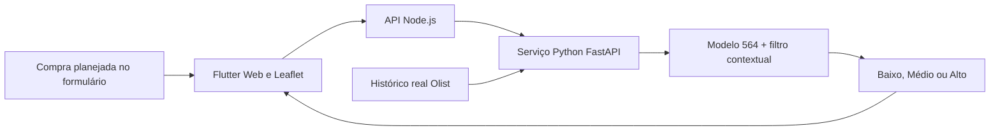
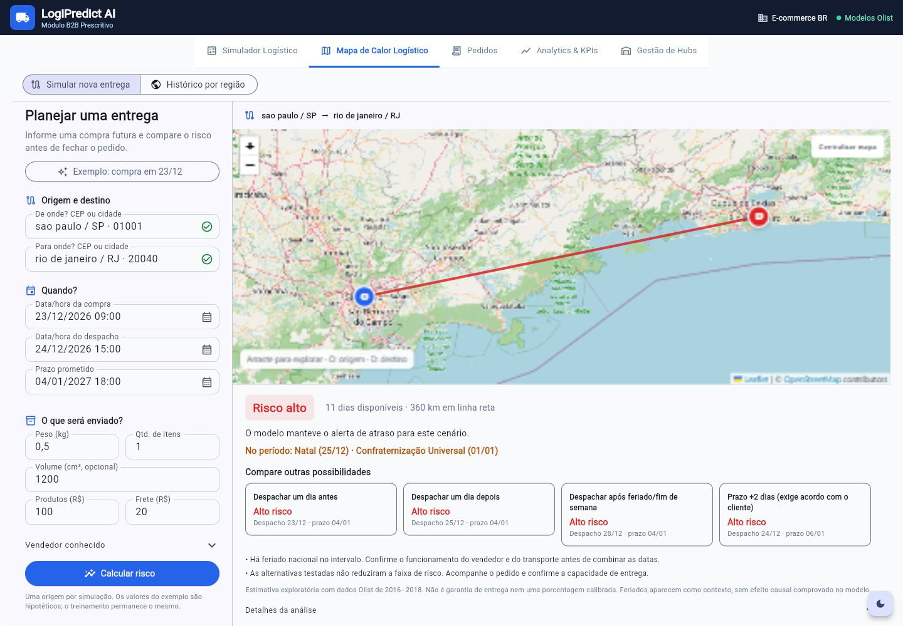
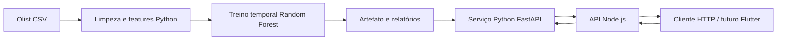
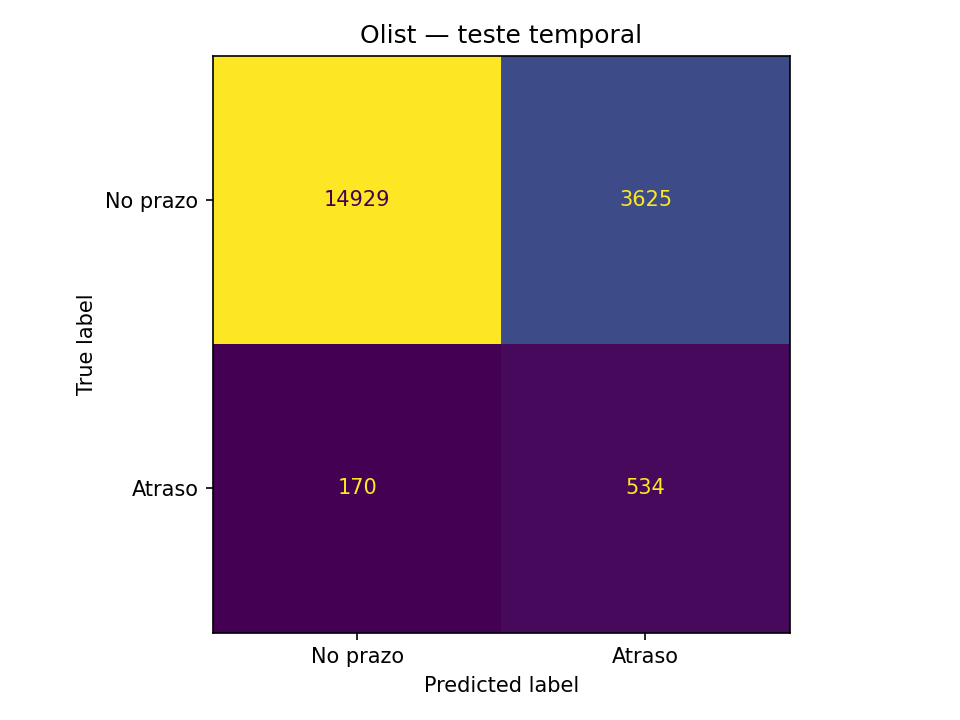

# 📦 LogiPredict AI — entrega consolidada

<div align="center">

**Previsão de risco de atraso com dados reais da Olist**<br>
Flutter Web · Leaflet · Node.js · FastAPI · Random Forest · CatBoost

**Versão de entrega: `main` · Atualização de 22/11/2026**

[Começar](#como-executar-esta-versão) · [Mapa](#mapa-planejar-uma-compra-futura) · [Modelos e resultados](#modelos-finais-e-resultados) · [Guia da demonstração](docs/mapa-e-demonstracao.md) · [Preparação da feira](docs/entrega-final-abp.md)

[Aplicativo Android e APK](docs/android-apk.md)

</div>

> **Versão atual:** a `main` reúne a aplicação, o mapa logístico, os dois
> notebooks finais, os pesos treinados, o catálogo geográfico e os resultados
> da avaliação. O mapa usa o modelo 564 + filtro contextual.

## O que esta atualização entrega

| Área | O que está disponível |
| --- | --- |
| **Planejamento de entregas** | Simulação de uma compra futura com datas, origem, destino, peso, volume, quantidade e valores |
| **Mapa interativo** | Leaflet com ruas/cidades do OpenStreetMap, formulário à esquerda e classificação da entrega |
| **Trajeto rodoviário** | Percurso por estradas no Web e no Android, distância e tempo de direção pelo OpenRouteService, com cache no backend |
| **Histórico regional** | Atrasos observados na Olist por região e UF, com hubs cadastrados no mapa |
| **Comparação de alternativas** | Novas previsões ao variar o despacho ou o prazo, com indicação de feriados no intervalo |
| **Aprendizagem de máquina** | Modelo 564 + filtro utilizado pelo novo mapa; modelo 613 + filtro preservado para comparação |
| **Operação existente** | Simulador logístico, importação CSV, consulta de pedidos, indicadores e gestão de hubs mantidos |
| **Integração** | Flutter → API Node.js → serviço Python → pesos treinados, com validações e mensagens de erro/carregamento |



O treinamento acontece offline. Ao clicar em **Calcular risco**, o serviço
carrega os pesos preservados e analisa as entradas; não treina outro modelo
nem transforma a simulação em um pedido operacional salvo.

## Mapa: planejar uma compra futura



*A imagem mostra um cenário hipotético de compra em 23/12. A classificação é
retornada pelo modelo preservado, e os feriados aparecem como contexto.*

1. Abra **Mapa de Calor Logístico → Simular nova entrega**.
2. Pesquise origem e destino por **CEP ou cidade** e selecione uma sugestão.
3. Informe compra, despacho, prazo prometido e características da encomenda.
4. Clique em **Calcular risco** para consultar a classificação, o trajeto
   geográfico e as alternativas comparadas.
5. Para conhecer o fluxo, use **Exemplo: compra em 23/12** e depois altere os
   campos para pesquisar outros cenários.

O formulário não exige selecionar um pedido antigo. Os locais vêm de um catálogo
real de **19.011 prefixos CEP**; as coordenadas são aproximadas. O ID do vendedor
é opcional: quando não informado, a análise usa o contexto de rota/região,
sem atribuir ao pedido o histórico de outro vendedor. O catálogo também preserva
**3.095 vendedores reais** para consultas compatíveis com a base.

As faixas representam a decisão das duas etapas do modelo:

| Faixa | Interpretação |
| --- | --- |
| **Baixo** | A primeira etapa não gerou alerta de atraso |
| **Médio** | A primeira etapa gerou alerta e o filtro contextual o retirou |
| **Alto** | O modelo final manteve o alerta |

Na vista **Histórico por região**, as taxas são atrasos que ocorreram na base,
não previsões para novas compras. Selecione uma região na lista para aproximar
ou clique no nome da região no mapa para consultar suas UFs.

Para reduzir o custo de navegação, apenas um mapa fica ativo. O histórico usa
cache de CSVs/agregados, a busca de CEP não inicializa o modelo e a previsão
futura não recalcula a avaliação dos 19.258 pedidos antigos. Zoom e arraste
ficam sob controle do Leaflet, sem repassar movimentos do mouse ao Flutter.
As ruas do OpenStreetMap precisam de internet; a biblioteca Leaflet é local.

O planejamento também permite visualizar o percurso pelas estradas. Consulte
o [guia de rotas rodoviárias](docs/rotas-rodoviarias.md) para configurar o
OpenRouteService e testar a consulta. A distância rodoviária complementa a
visualização; os atributos usados pelo modelo preservado continuam iguais.

## Modelos finais e resultados

A avaliação preservada contém **19.258 pedidos, sendo 704 atrasos reais**.

| Resultado | **564 + filtro — usado no novo mapa** | **613 + filtro — alternativa preservada** |
| --- | ---: | ---: |
| Atrasos reais encontrados | 564 | 613 |
| Atrasos não detectados | 140 | 91 |
| Falsos alertas de atraso | 4.358 | 6.774 |
| Entregas no prazo sem alerta | 14.196 | 11.780 |
| Recall: proporção dos atrasos encontrados | 80,11% | 87,07% |
| Precisão: proporção dos alertas que eram atrasos | 11,46% | 8,30% |

O **564 + filtro** combina a Random Forest com um revisor contextual CatBoost.
O **613 + filtro** preserva a combinação de CatBoost, sobrevivência AFT e filtro
contextual. O primeiro gera menos falsos alertas; o segundo encontra mais atrasos.
O novo mapa utiliza exclusivamente o primeiro, versão `modelo_564_filter`.
Os endpoints anteriores continuam usando seu contrato e modelo original.

Os atributos incluem datas de compra/despacho/prazo, origem/destino, distância
aproximada, peso, volume, quantidade, valor dos produtos, frete e contexto
histórico disponível antes do despacho. A entrega efetiva do próprio pedido
não é uma entrada de previsão. Comparações de cenários mantêm o corte histórico
do cenário base, evitando consultar entregas futuras para sugerir outra data.

| Arquivo | Finalidade |
| --- | --- |
| [Notebook 564 + filtro](ML/modelos_finais/Modelo_564_atrasos_4358_falsos_alertas_140_perdidos.ipynb) | Carregar, explicar e avaliar o modelo selecionado |
| [Notebook 613 + filtro](ML/modelos_finais/Modelo_613_atrasos_6774_falsos_alertas_91_perdidos.ipynb) | Carregar, explicar e avaliar a alternativa preservada |
| [Pesos e metadados](ML/modelos_finais/artefatos/) | Modelos `.joblib`, configurações e hashes de integridade |
| [Dados de avaliação](ML/modelos_finais/dados/) | Amostra real, previsões preservadas e origem dos dados |
| [Código de apoio](ML/modelos_finais/codigo/) | Transformações, histórico, validação, inferência e reajuste opcional |
| [Como abrir os notebooks](ML/modelos_finais/LEIA_ME.md) | Kernel, dependências e explicação dos arquivos |

Abra os notebooks no VS Code, selecione o Python da `.venv` e use **Executar Tudo**.
A execução padrão carrega os pesos e verifica os resultados; não retreina nem
sobrescreve os modelos. O reajuste opcional do filtro está documentado no guia
e exige os dados originais correspondentes. Mantenha as pastas de apoio junto
dos notebooks.

## Como executar esta versão

Para atualizar uma cópia local com as alterações já salvas:

```bash
git switch main
git pull --ff-only origin main
```

O guia [Iniciar no VS Code / PowerShell](#iniciar-no-vs-code--powershell) descreve
a instalação das dependências e a execução dos três serviços:
**Python (8000)**, **Node.js (3001)** e **Flutter (8080)**. A aplicação abre em
[localhost:8080](http://localhost:8080). Os dois modelos finais e o catálogo
necessário à nova simulação já acompanham esta versão.

Se os serviços já estavam abertos antes da atualização, encerre-os e inicie-os
novamente com os comandos do guia. Use **Ctrl+Shift+R** no navegador para
recarregar os arquivos atuais. Para demonstração no Web, o comando Flutter
inclui `--release`.

## Aplicativo Android

A interface também funciona como aplicativo Android, com navegação inferior,
formulários adaptados ao celular e mapa nativo. O endereço do servidor pode ser
configurado no cabeçalho do aplicativo para conexão por USB, Wi-Fi ou HTTPS.
O Web mantém o mapa Leaflet e os endereços definidos no build.

Para gerar o APK na pasta `flutter_app`:

```powershell
flutter pub get
flutter build apk --release --dart-define=API_BASE_URL=http://127.0.0.1:3001
```

O arquivo fica em `flutter_app/build/app/outputs/flutter-apk/app-release.apk`.
No celular, o APK substitui o Flutter Web; os serviços Node.js e Python
continuam necessários no computador ou servidor. O build de demonstração usa
a chave de desenvolvimento local. A publicação em loja exige assinatura própria.

O [guia Android](docs/android-apk.md) explica instalação, conexão com a API,
requisitos, testes e limitações.

## API, validação e apresentação

| Endpoint público | Uso |
| --- | --- |
| `GET /api/v1/map/locations?q=...` | Buscar CEP, cidade ou UF no catálogo real |
| `POST /api/v1/map/forecast` | Analisar uma entrega planejada com entradas completas |
| `GET /api/v1/orders` | Consultar pedidos operacionais importados |
| `POST /api/v1/predictions` | Executar a previsão do simulador existente |
| `POST /predict` | Consultar a regra simples de risco com referência histórica, preservada |

[Contrato da API](docs/api.md) · [Arquitetura operacional](docs/evolucao-operacional.md) ·
[Guia do mapa](docs/mapa-e-demonstracao.md) ·
[Validações e limites dos testes](docs/validation.md) ·
[Roteiro e pendências para a ABP/feira](docs/entrega-final-abp.md).

Na validação local desta entrega: **56 testes Python aprovados, 158 Node
aprovados e 1 ignorado, 67 Flutter aprovados e build Web concluído**.
Também foram verificados busca de CEP, calendário, previsão, troca entre vistas,
zoom, arraste e detalhes por UF no navegador. PostgreSQL, Docker e Mobile
continuam exigindo homologação própria.

> **Limitações da avaliação:** a base Olist é de 2016–2018 e o benchmark
> é retrospectivo/exploratório, com o período final já consultado em pesquisas
> anteriores. Dos 564 atrasos encontrados, 434 foram antecipados e 130 já
> estavam vencidos no despacho; no alternativo, são 481 e 132. O score não é
> uma probabilidade calibrada, e baixo risco não garante entrega no prazo.
> Feriados fixos nacionais aparecem como contexto de calendário; o modelo
> não aprende um efeito explícito de feriado nem comprova causa de atraso.
> Renegociar o prazo não acelera o transporte. Uma data alternativa só recebe
> sugestão de faixa menor quando a comparação realmente reduz essa faixa.

---

## Guias e histórico do projeto

As próximas seções detalham a instalação, os recursos da plataforma e os
resultados das primeiras sprints.

# LogiPredict AI — versão integrada

Plataforma acadêmica para pesquisar entregas e apoiar o acompanhamento de risco
de atraso no e-commerce, com dados históricos reais da Olist. Flutter Web,
Node.js e Python/FastAPI, com modelos treinados offline.

A `main` contém a aplicação completa e os dois modelos finais de classificação
de risco. A `machineLearning` reúne os experimentos e a pesquisa dos modelos.

[Guia do mapa e demonstração](docs/mapa-e-demonstracao.md) ·
[Preparação da ABP e da feira](docs/entrega-final-abp.md) ·
[API](docs/api.md) · [Notebooks finais](ML/modelos_finais/LEIA_ME.md).

## Recursos atuais

- Simulador logístico, importação de pedidos, indicadores e cadastro de hubs.
- Simulação de compra futura com datas, origem, destino, CEP e dados do pacote.
- Comparação de cenários com o **modelo 564 + filtro CatBoost**, preservado.
- Leaflet no navegador, com ruas/cidades, histórico por região e apenas um mapa ativo.
- Validações, estados de carregamento/erro e testes nas três camadas.
- PostgreSQL com fallback JSON nos fluxos operacionais existentes.

## Iniciar no VS Code / PowerShell

Pré-requisitos: Python 3.12, Node.js 22+ e Flutter. Na raiz do repositório,
instale as dependências uma vez, mantendo a `.venv` se ela já existe:

```powershell
python -m venv .venv
.\.venv\Scripts\python.exe -m pip install -r back\ml\requirements-docker.txt
npm.cmd ci --prefix back
cd flutter_app
flutter pub get
```

Abra três terminais, **cada um começando na raiz**:

**Terminal 1 — Python**

```powershell
cd back\ml
..\..\.venv\Scripts\python.exe -m uvicorn logipredict.service:app --host 127.0.0.1 --port 8000
```

**Terminal 2 — Node.js**

```powershell
cd back
$env:HUBS_FILE = 'data/hubs/hubs.json'
$env:ORDERS_FILE = 'data/hubs/orders.json'
$env:PREDICTIONS_FILE = 'data/hubs/predictions.json'
$env:PREDICTIONS_JOURNAL_FILE = 'data/hubs/predictions.jsonl'
npm.cmd start
```

**Terminal 3 — Flutter**

```powershell
cd flutter_app
flutter run -d chrome --release --web-port 8080 --dart-define=API_BASE_URL=http://127.0.0.1:3001
```

Abra [a aplicação local](http://localhost:8080) e entre em **Mapa de Calor
Logístico → Simular nova entrega**. O formulário à esquerda recebe uma compra
planejada, sem selecionar um pedido antigo. **Histórico por região** consulta as taxas observadas.
Os pesos e o catálogo estão versionados; o novo mapa não exige retreinamento,
download dos CSVs originais ou PostgreSQL. Encerre instâncias anteriores antes
de reiniciar nas mesmas portas.

## Resultado do modelo do novo mapa

| Resultado retrospectivo | Modelo 564 + filtro |
| --- | ---: |
| Pedidos avaliados / atrasos reais | 19.258 / 704 |
| Atrasos encontrados / não detectados | 564 / 140 |
| Falsos alertas / entregas no prazo sem alerta | 4.358 / 14.196 |
| Recall / precisão dos alertas | 80,11% / 11,46% |

Dos 564, **434 foram antecipações e 130 já estavam vencidos no despacho**.
O score não é uma probabilidade calibrada. O teste final foi consultado durante
as pesquisas anteriores: o resultado é exploratório, sem comprovar desempenho
em uma operação nova. A base é de 2016–2018 e não identifica transportadora.

As faixas baixo/médio/alto representam as duas etapas da decisão: sem alerta
inicial, alerta retirado pelo filtro e alerta mantido. Feriados são contexto do
calendário; este modelo não usa feriado como atributo explícito. Renegociar um
prazo não acelera a entrega física. A simulação não altera pedidos salvos.

O modelo alternativo de 613 atrasos e 6.774 falsos alertas está preservado para
comparação. O novo mapa utiliza exclusivamente `modelo_564_filter`; as rotas
antigas mantêm seu contrato e modelo original.

## Testar

```powershell
$env:PYTHONPATH = 'back/ml'
.\.venv\Scripts\python.exe -m pytest back/ml/tests -q
npm.cmd test --prefix back
cd flutter_app
flutter test
```

O teste do mapa reproduz todas as previsões preservadas e verifica a matriz
564/4358/140/14196. Há testes de filtros, cenários, isolamento temporal e
regressão nas telas existentes. Testes com PostgreSQL e builds Docker/Mobile
exigem homologação própria.

<details>
<summary>Documentação original da Sprint 1 — registro histórico</summary>

Os comandos e o estado das funcionalidades abaixo registram a primeira etapa.
Para executar e apresentar a aplicação atual, use os guias acima.

<div align="center">

# 📦 LogiPredict AI

**Gestão logística e previsão de atrasos no e-commerce brasileiro**

Projeto Integrador · Desenvolvimento de Software Multiplataforma · FATEC Jacareí

**[HallwayTech](https://github.com/hallwaytechgrupo) & [Octacode](https://github.com/octacodeteam)**

[Objetivo](#-objetivo-do-projeto) · [Entrega atual](#-entrega-atual) · [Executar](#-como-executar) · [Resultados](#-resultados-do-primeiro-experimento) · [Backlog](docs/backlog.md) · [Sprints](#-sprints) · [Equipe](#-equipe)

</div>

---

## 🎯 Objetivo do projeto

Antecipar o risco de atraso de pedidos no momento do despacho, apoiando gestores de e-commerce na priorização do acompanhamento logístico. A solução usa dados públicos brasileiros da Olist, processamento e Machine Learning em Python e uma API em Node.js.

A visão do produto inclui uma interface **Flutter Web e Mobile** com consulta de risco e visualização de gargalos no Brasil. **A interface é uma etapa futura:** a primeira entrega concentra ciência de dados, treinamento e integração inicial da API.

## 📖 Problema e proposta

Distância, características dos produtos e prazo prometido podem influenciar a entrega. O projeto investiga essas relações para classificar pedidos com maior risco de atraso e consultar a distribuição histórica de atrasos por UF.

A unidade desta versão é o **pedido**, pois a base não individualiza pacotes nem identifica transportadoras. A distância é uma aproximação em linha reta entre origem e destino. O sistema ainda não estima uma nova data de entrega nem identifica a causa de um atraso.

## ✅ Entrega atual

| Recurso | Situação |
| --- | --- |
| Download oficial da Olist e registro da origem | Implementado |
| Limpeza, validação e integração de seis CSVs | Implementado |
| Engenharia de atributos disponíveis no despacho | Implementado |
| Treino Random Forest e comparação com baseline | Executado com a Olist real |
| Avaliação temporal, métricas e gráficos | [Relatório disponível](reports/olist/README.md) |
| Inferência Python com validação e OpenAPI | Implementado |
| API Node.js consumindo o serviço Python | Implementado |
| Agregados históricos por UF | Implementado; sem mapa nesta fase |
| Testes Python, Node.js e integração completa | Executados localmente |
| Automação de testes no GitHub Actions | Configurada; execução remota após envio |
| Autenticação, persistência e regras operacionais | Backlog da próxima review |
| Flutter Web/Mobile e mapa interativo | Planejado |

## 🧰 Tecnologias

| Camada | Tecnologias | Responsabilidade |
| --- | --- | --- |
| Dados e IA | Python, pandas, NumPy, scikit-learn | Limpeza, features, Random Forest e avaliação |
| Inferência | FastAPI, Pydantic, joblib | Carregamento do modelo, validação e previsões |
| API pública | Node.js 22+, Express 5, Helmet | Rotas REST e integração com o serviço Python |
| Relatórios | Matplotlib e JSON/CSV | Métricas, gráficos e rastreabilidade |
| Qualidade | pytest, Ruff, node:test, GitHub Actions | Testes e verificações automatizadas |
| Interface futura | Flutter | Aplicação Web e Mobile |

## 🏗️ Arquitetura



O modelo é treinado offline e carregado uma vez pelo serviço Python. A API Node.js o consulta por HTTP interno. [Detalhes da arquitetura](docs/architecture.md).

## 🗂️ Estrutura e branches

| Branch | Finalidade |
| --- | --- |
| `main` | Documentação geral, proposta, backlog e evidências acadêmicas |
| `back` | API Node.js, pipeline e serviço de IA Python, testes e documentação |
| `front` | Reservada ao desenvolvimento futuro da interface Flutter |
| `machineLearning` | Branch já existente na origem; preservada nesta entrega |

Estrutura disponível em `back`:

```text
LogiPredictAI/
├── api/                   # API Node.js e testes
├── ml/
│   ├── logipredict/        # Preparação, features, treino e inferência
│   └── tests/              # Testes do pipeline e serviço
├── data/
│   ├── raw/               # CSVs Olist locais, ignorados pelo Git
│   └── processed/         # Base por pedido, ignorada pelo Git
├── models/                # Artefatos locais, ignorados pelo Git
├── reports/olist/          # Resultados agregados do experimento real
├── examples/              # JSON de previsão e requisições HTTP
├── scripts/               # Download, execução local e teste integrado
├── docs/                  # Backlog, API, arquitetura e sprint
├── .github/workflows/     # Integração contínua
├── pyproject.toml         # Dependências diretas do Python
└── requirements.lock       # Versões do ambiente validado
```

[Fluxo de publicação de main e back](docs/github.md). A branch `front` não é necessária para a primeira sprint.

## 🚀 Como executar

Pré-requisitos: **Python 3.12 ou 3.13**, **Node.js 22+**, npm e Git. Ambiente verificado nesta entrega: Windows, Python 3.13 e Node 22.

### 1. Obter o código e instalar

```powershell
git clone https://github.com/hallwaytechgrupo/LogiPredictAI.git
cd LogiPredictAI
git switch back
py -3.13 -m venv .venv
.\.venv\Scripts\python.exe -m pip install -r requirements.lock
.\.venv\Scripts\python.exe -m pip install -e '.[dev]'
npm.cmd ci --prefix api
```

Na cópia local preparada para esta entrega, o ambiente e o modelo real já foram gerados. Em uma nova máquina, siga as próximas etapas. No Linux/macOS, crie o ambiente com `python3 -m venv .venv`, use `.venv/bin/python` e `npm` nos comandos.

### 2. Baixar, tratar e treinar com a Olist

```powershell
.\.venv\Scripts\python.exe scripts/download_olist.py
.\.venv\Scripts\python.exe -m logipredict.prepare
.\.venv\Scripts\python.exe -m logipredict.train --source olist --model-dir models/olist --report-dir reports/local/olist
```

Se o Kaggle solicitar login, use o download manual descrito em [data/README.md](data/README.md). O script evita sobrescrever CSVs existentes. [Protocolo de dados e treinamento](docs/data-science.md).

### 3. Iniciar os dois serviços

```powershell
.\.venv\Scripts\python.exe scripts/run_local.py
```

- API: [http://127.0.0.1:3001/health](http://127.0.0.1:3001/health).
- Disponibilidade do modelo: [http://127.0.0.1:3001/ready](http://127.0.0.1:3001/ready).
- OpenAPI interativa do serviço Python: [http://127.0.0.1:8000/docs](http://127.0.0.1:8000/docs).
- `Ctrl+C` encerra ambos. Logs em `reports/local/`. Portas alternativas: `--port 3010 --ml-port 8010`.

Para iniciar separadamente, na raiz execute `python -m uvicorn logipredict.service:app --host 127.0.0.1 --port 8000` com o Python do ambiente virtual; em outro terminal entre em `api` e execute `npm.cmd start`.

### 4. Consultar uma previsão

Em outro terminal, na raiz:

```powershell
$body = Get-Content examples/prediction.json -Raw
Invoke-RestMethod http://127.0.0.1:3001/api/v1/predictions -Method Post -ContentType 'application/json' -Body $body
```

O retorno inclui score de atraso, decisão, limiar, versão do modelo, origem dos dados e avisos. [Contrato completo e erros](docs/api.md).

### Alternativa: demonstração sem baixar a Olist

```powershell
.\.venv\Scripts\python.exe -m logipredict.demo
.\.venv\Scripts\python.exe -m logipredict.train --input data/processed/demo.csv --source synthetic --model-dir models/demo --report-dir reports/local/demo
.\.venv\Scripts\python.exe scripts/run_local.py --model-dir models/demo
```

Essa alternativa usa **dados artificiais**, identificados como `synthetic: true`. Verifica instalação e integração; não demonstra desempenho real na Olist.

## 📊 Resultados do primeiro experimento

Fonte: Olist v2. Dos **99.441 pedidos**, **96.281** passaram pelos critérios de limpeza e elegibilidade. A classe atraso representa 6,78% dessa amostra. O teste temporal contém 19.258 pedidos, com 704 atrasos (3,66%).

| Métrica no teste temporal | Random Forest | Baseline majoritária |
| --- | ---: | ---: |
| Precisão dos alertas | 12,84% | 0,00% |
| Recall dos atrasos | 75,85% | 0,00% |
| F1 | 0,2196 | 0,0000 |
| Average Precision (AP) | 0,3692 | 0,0366 |
| ROC AUC | 0,8667 | 0,5000 |
| Acurácia | 80,29% | 96,34% |
| Brier score (menor é melhor) | 0,1018 | 0,0354 |

Com limiar de **0,39**, escolhido somente na validação, o modelo detectou 534 dos 704 atrasos, mas gerou **3.625 falsos alertas**. A baseline tem alta acurácia por sempre prever a classe predominante e não detectar atrasos. O Random Forest melhora a ordenação de risco, mas sua baixa precisão e Brier pior evidenciam que o score ainda precisa de calibração e validação operacional.



[Relatório e gráficos](reports/olist/README.md) · [Qualidade dos dados](reports/olist/data_quality.json) · [Métricas e parâmetros](reports/olist/metrics.json)

Os resultados são uma referência inicial reproduzível, sem afirmar prontidão comercial. A base cobre 2016–2018, não identifica transportadoras e não descreve o cenário logístico atual.

## 🧪 Testes

```powershell
.\.venv\Scripts\python.exe -m pytest -q
.\.venv\Scripts\python.exe -m ruff check ml scripts
npm.cmd test --prefix api
npm.cmd run check --prefix api
.\.venv\Scripts\python.exe scripts/run_local.py --smoke
```

O último comando inicia os serviços, testa a integração com o modelo real e os encerra. Execute-o com as portas livres. Para testar serviços já iniciados, use `python scripts/smoke_test.py` com o ambiente virtual. A CI usa dados sintéticos para verificar o fluxo sem depender do download externo.

## 📅 Sprints

| Fase | Objetivo | Evidência / planejamento |
| --- | --- | --- |
| 1ª review | Ciência de dados, IA e estrutura inicial da API | [Sprint 1 e roteiro de apresentação](docs/sprints/sprint-1.md) |
| 2ª review | Regras, autenticação, persistência e validação do modelo | [Backlog](docs/backlog.md) |
| Etapa seguinte | Flutter Web/Mobile e mapa | Planejamento a refinar |

Calendário das sprints 2 e 3, responsáveis por tarefas e aceite das reviews: a definir pela equipe. [Requisitos e histórias de usuário](docs/backlog.md).

Review da Sprint 1 informada para **20/10/2026**. [Cronograma proposto e cartões para o EntregaLab](docs/cronograma-entregalab.md) · [Explicação, testes e evolução do modelo](docs/guia-projeto-e-testes.md) · [Descrição pronta para o PR da Sprint 1](docs/pr-sprint-1.md).

## 📚 Metodologia

O projeto adota **Scrum**, com backlog priorizado, entregas incrementais, acompanhamento das tarefas e revisões ao fim de cada sprint. A documentação reúne a visão do produto e evidências técnicas para apoiar refinamento e avaliação acadêmica. [Como contribuir](CONTRIBUTING.md).

## 👥 Equipe

| Integrante | Papel informado no projeto | GitHub |
| --- | --- | --- |
| Marcos Oliveira | Product Owner | [@MarckNero](https://github.com/marcknero) |
| Gustavo Hammes | Scrum Master | [@GustavoHammes](https://github.com/GustavoHammes) |
| Alisson Gritti | Desenvolvedor | [@AlissonGritti](https://github.com/alissongritti) |
| Mário Cesar | Desenvolvedor | [@MariosC3sar](https://github.com/MariosC3sar) |
| Igor Lima | Desenvolvedor | [@IgorSantosL](https://github.com/IgorSantosL) |
| Vinicius Lemmes | Desenvolvedor | [@viniilemes](https://github.com/viniilemes) |

**Professor Focal Point:** Leandro Toss Hoffmann.

</details>

## Execução em nuvem

A aplicação também dispõe de implantação gerenciada com frontend Flutter Web,
API Node.js e inferência Python em serviços independentes, além de PostgreSQL
separado no Neon. O mapa mantém os pesos do modelo **564 + filtro contextual**.

**Acesso público:** [LogiPredict AI](https://logipredict-ai-abp.pages.dev),
com interface hospedada no Cloudflare Pages.

Consulte o [guia de implantação e testes na nuvem](docs/nuvem.md) para os
endereços, configuração do APK, persistência e limites das franquias gratuitas.
As instruções de execução local continuam disponíveis neste README.
