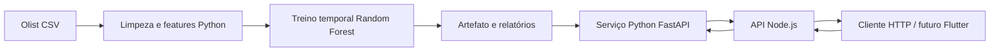
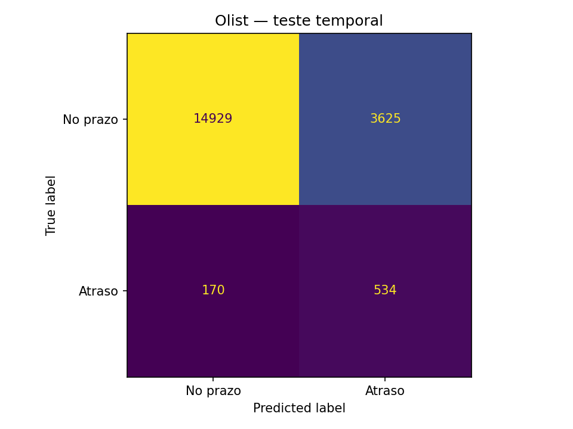

<div align="center">

# 📦 LogiPredict AI

**Gestão logística e previsão de atrasos no e-commerce brasileiro**

Projeto Integrador · Desenvolvimento de Software Multiplataforma · FATEC Jacareí

**[HallwayTech](https://github.com/hallwaytechgrupo) & [Octacode](https://github.com/octacodeteam)**

[Objetivo](#-objetivo-do-projeto) · [Entrega atual](#-entrega-atual) · [Executar](#-como-executar) · [Resultados](#-resultados-do-primeiro-experimento) · [Backlog](docs/backlog.md) · [Sprints](#-sprints) · [Equipe](#-equipe)

</div>

---

## 🎯 Objetivo do projeto

Antecipar o risco de atraso de pedidos no momento do despacho, apoiando gestores de e-commerce na priorização do acompanhamento logístico. A solução usa dados públicos brasileiros da Olist, processamento e Machine Learning em Python e uma API em Node.js.

A visão do produto inclui uma interface **Flutter Web e Mobile** com consulta de risco e visualização de gargalos no Brasil. **A interface é uma etapa futura:** a primeira entrega concentra ciência de dados, treinamento e integração inicial da API.

## 📖 Problema e proposta

Distância, características dos produtos e prazo prometido podem influenciar a entrega. O projeto investiga essas relações para classificar pedidos com maior risco de atraso e consultar a distribuição histórica de atrasos por UF.

A unidade desta versão é o **pedido**, pois a base não individualiza pacotes nem identifica transportadoras. A distância é uma aproximação em linha reta entre origem e destino. O sistema ainda não estima uma nova data de entrega nem identifica a causa de um atraso.

## ✅ Entrega atual

| Recurso | Situação |
| --- | --- |
| Download oficial da Olist e registro da origem | Implementado |
| Limpeza, validação e integração de seis CSVs | Implementado |
| Engenharia de atributos disponíveis no despacho | Implementado |
| Treino Random Forest e comparação com baseline | Executado com a Olist real |
| Avaliação temporal, métricas e gráficos | [Relatório disponível](reports/olist/README.md) |
| Inferência Python com validação e OpenAPI | Implementado |
| API Node.js consumindo o serviço Python | Implementado |
| Agregados históricos por UF | Implementado; sem mapa nesta fase |
| Testes Python, Node.js e integração completa | Executados localmente |
| Automação de testes no GitHub Actions | Configurada; execução remota após envio |
| Autenticação, persistência e regras operacionais | Backlog da próxima review |
| Flutter Web/Mobile e mapa interativo | Planejado |

## 🧰 Tecnologias

| Camada | Tecnologias | Responsabilidade |
| --- | --- | --- |
| Dados e IA | Python, pandas, NumPy, scikit-learn | Limpeza, features, Random Forest e avaliação |
| Inferência | FastAPI, Pydantic, joblib | Carregamento do modelo, validação e previsões |
| API pública | Node.js 22+, Express 5, Helmet | Rotas REST e integração com o serviço Python |
| Relatórios | Matplotlib e JSON/CSV | Métricas, gráficos e rastreabilidade |
| Qualidade | pytest, Ruff, node:test, GitHub Actions | Testes e verificações automatizadas |
| Interface futura | Flutter | Aplicação Web e Mobile |

## 🏗️ Arquitetura



O modelo é treinado offline e carregado uma vez pelo serviço Python. A API Node.js o consulta por HTTP interno. [Detalhes da arquitetura](docs/architecture.md).

## 🗂️ Estrutura e branches

| Branch | Finalidade |
| --- | --- |
| `main` | Documentação geral, proposta, backlog e evidências acadêmicas |
| `back` | API Node.js, pipeline e serviço de IA Python, testes e documentação |
| `front` | Reservada ao desenvolvimento futuro da interface Flutter |
| `machineLearning` | Branch já existente na origem; preservada nesta entrega |

Estrutura disponível em `back`:

```text
LogiPredictAI/
├── api/                   # API Node.js e testes
├── ml/
│   ├── logipredict/        # Preparação, features, treino e inferência
│   └── tests/              # Testes do pipeline e serviço
├── data/
│   ├── raw/               # CSVs Olist locais, ignorados pelo Git
│   └── processed/         # Base por pedido, ignorada pelo Git
├── models/                # Artefatos locais, ignorados pelo Git
├── reports/olist/          # Resultados agregados do experimento real
├── examples/              # JSON de previsão e requisições HTTP
├── scripts/               # Download, execução local e teste integrado
├── docs/                  # Backlog, API, arquitetura e sprint
├── .github/workflows/     # Integração contínua
├── pyproject.toml         # Dependências diretas do Python
└── requirements.lock       # Versões do ambiente validado
```

[Fluxo de publicação de main e back](docs/github.md). A branch `front` não é necessária para a primeira sprint.

## 🚀 Como executar

Pré-requisitos: **Python 3.12 ou 3.13**, **Node.js 22+**, npm e Git. Ambiente verificado nesta entrega: Windows, Python 3.13 e Node 22.

### 1. Obter o código e instalar

```powershell
git clone https://github.com/hallwaytechgrupo/LogiPredictAI.git
cd LogiPredictAI
git switch back
py -3.13 -m venv .venv
.\.venv\Scripts\python.exe -m pip install -r requirements.lock
.\.venv\Scripts\python.exe -m pip install -e '.[dev]'
npm.cmd ci --prefix api
```

Na cópia local preparada para esta entrega, o ambiente e o modelo real já foram gerados. Em uma nova máquina, siga as próximas etapas. No Linux/macOS, crie o ambiente com `python3 -m venv .venv`, use `.venv/bin/python` e `npm` nos comandos.

### 2. Baixar, tratar e treinar com a Olist

```powershell
.\.venv\Scripts\python.exe scripts/download_olist.py
.\.venv\Scripts\python.exe -m logipredict.prepare
.\.venv\Scripts\python.exe -m logipredict.train --source olist --model-dir models/olist --report-dir reports/local/olist
```

Se o Kaggle solicitar login, use o download manual descrito em [data/README.md](data/README.md). O script evita sobrescrever CSVs existentes. [Protocolo de dados e treinamento](docs/data-science.md).

### 3. Iniciar os dois serviços

```powershell
.\.venv\Scripts\python.exe scripts/run_local.py
```

- API: [http://127.0.0.1:3001/health](http://127.0.0.1:3001/health).
- Disponibilidade do modelo: [http://127.0.0.1:3001/ready](http://127.0.0.1:3001/ready).
- OpenAPI interativa do serviço Python: [http://127.0.0.1:8000/docs](http://127.0.0.1:8000/docs).
- `Ctrl+C` encerra ambos. Logs em `reports/local/`. Portas alternativas: `--port 3010 --ml-port 8010`.

Para iniciar separadamente, na raiz execute `python -m uvicorn logipredict.service:app --host 127.0.0.1 --port 8000` com o Python do ambiente virtual; em outro terminal entre em `api` e execute `npm.cmd start`.

### 4. Consultar uma previsão

Em outro terminal, na raiz:

```powershell
$body = Get-Content examples/prediction.json -Raw
Invoke-RestMethod http://127.0.0.1:3001/api/v1/predictions -Method Post -ContentType 'application/json' -Body $body
```

O retorno inclui score de atraso, decisão, limiar, versão do modelo, origem dos dados e avisos. [Contrato completo e erros](docs/api.md).

### Alternativa: demonstração sem baixar a Olist

```powershell
.\.venv\Scripts\python.exe -m logipredict.demo
.\.venv\Scripts\python.exe -m logipredict.train --input data/processed/demo.csv --source synthetic --model-dir models/demo --report-dir reports/local/demo
.\.venv\Scripts\python.exe scripts/run_local.py --model-dir models/demo
```

Essa alternativa usa **dados artificiais**, identificados como `synthetic: true`. Verifica instalação e integração; não demonstra desempenho real na Olist.

## 📊 Resultados do primeiro experimento

Fonte: Olist v2. Dos **99.441 pedidos**, **96.281** passaram pelos critérios de limpeza e elegibilidade. A classe atraso representa 6,78% dessa amostra. O teste temporal contém 19.258 pedidos, com 704 atrasos (3,66%).

| Métrica no teste temporal | Random Forest | Baseline majoritária |
| --- | ---: | ---: |
| Precisão dos alertas | 12,84% | 0,00% |
| Recall dos atrasos | 75,85% | 0,00% |
| F1 | 0,2196 | 0,0000 |
| Average Precision (AP) | 0,3692 | 0,0366 |
| ROC AUC | 0,8667 | 0,5000 |
| Acurácia | 80,29% | 96,34% |
| Brier score (menor é melhor) | 0,1018 | 0,0354 |

Com limiar de **0,39**, escolhido somente na validação, o modelo detectou 534 dos 704 atrasos, mas gerou **3.625 falsos alertas**. A baseline tem alta acurácia por sempre prever a classe predominante e não detectar atrasos. O Random Forest melhora a ordenação de risco, mas sua baixa precisão e Brier pior evidenciam que o score ainda precisa de calibração e validação operacional.



[Relatório e gráficos](reports/olist/README.md) · [Qualidade dos dados](reports/olist/data_quality.json) · [Métricas e parâmetros](reports/olist/metrics.json)

Os resultados são uma referência inicial reproduzível, sem afirmar prontidão comercial. A base cobre 2016–2018, não identifica transportadoras e não descreve o cenário logístico atual.

## 🧪 Testes

```powershell
.\.venv\Scripts\python.exe -m pytest -q
.\.venv\Scripts\python.exe -m ruff check ml scripts
npm.cmd test --prefix api
npm.cmd run check --prefix api
.\.venv\Scripts\python.exe scripts/run_local.py --smoke
```

O último comando inicia os serviços, testa a integração com o modelo real e os encerra. Execute-o com as portas livres. Para testar serviços já iniciados, use `python scripts/smoke_test.py` com o ambiente virtual. A CI usa dados sintéticos para verificar o fluxo sem depender do download externo.

## 📅 Sprints

| Fase | Objetivo | Evidência / planejamento |
| --- | --- | --- |
| 1ª review | Ciência de dados, IA e estrutura inicial da API | [Sprint 1 e roteiro de apresentação](docs/sprints/sprint-1.md) |
| 2ª review | Regras, autenticação, persistência e validação do modelo | [Backlog](docs/backlog.md) |
| Etapa seguinte | Flutter Web/Mobile e mapa | Planejamento a refinar |

Calendário das sprints 2 e 3, responsáveis por tarefas e aceite das reviews: a definir pela equipe. [Requisitos e histórias de usuário](docs/backlog.md).

Review da Sprint 1 informada para **20/10/2026**. [Cronograma proposto e cartões para o EntregaLab](docs/cronograma-entregalab.md) · [Explicação, testes e evolução do modelo](docs/guia-projeto-e-testes.md) · [Descrição pronta para o PR da Sprint 1](docs/pr-sprint-1.md).

## 📚 Metodologia

O projeto adota **Scrum**, com backlog priorizado, entregas incrementais, acompanhamento das tarefas e revisões ao fim de cada sprint. A documentação reúne a visão do produto e evidências técnicas para apoiar refinamento e avaliação acadêmica. [Como contribuir](CONTRIBUTING.md).

## 👥 Equipe

| Integrante | Papel informado no projeto | GitHub |
| --- | --- | --- |
| Marcos Oliveira | Product Owner | [@MarckNero](https://github.com/marcknero) |
| Gustavo Hammes | Scrum Master | [@GustavoHammes](https://github.com/GustavoHammes) |
| Alisson Gritti | Desenvolvedor | [@AlissonGritti](https://github.com/alissongritti) |
| Mário Cesar | Desenvolvedor | [@MariosC3sar](https://github.com/MariosC3sar) |
| Igor Lima | Desenvolvedor | [@IgorSantosL](https://github.com/IgorSantosL) |
| Vinicius Lemmes | Desenvolvedor | [@viniilemes](https://github.com/viniilemes) |

**Professor Focal Point:** Leandro Toss Hoffmann.
