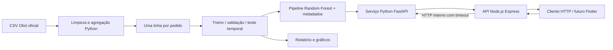

# Arquitetura da primeira entrega

O pipeline Python é executado offline. Ele produz `model.joblib`, metadados e agregados históricos por UF. O serviço de inferência carrega o artefato uma vez ao iniciar. O caminho `MODEL_DIR` pode apontar para `models/olist` ou para uma demonstração explicitamente sintética em `models/demo`.

A API Node.js oferece a fronteira REST para os clientes e centraliza o contrato, limite de payload, headers de segurança e tratamento de falhas do serviço Python. A validação semântica do pedido e as transformações de features ficam no Python para evitar duas implementações divergentes. Não há subprocesso Python por requisição.

`GET /health` indica que o processo Node responde; `GET /ready` também verifica a disponibilidade do modelo no Python. Um modelo ausente resulta em HTTP 503. Depois de treinar outro artefato, reinicie o serviço Python.

O agregado por UF mostra **atrasos observados na amostra histórica completa**. Ele não participa do treino como feature e não é uma previsão para o mapa futuro. A API retorna origem, período e identificação de dados sintéticos.

Nesta fase, não há persistência de pedidos, autenticação, histórico de previsões ou interface Flutter. Esses itens permanecem no backlog. Os serviços iniciam em `127.0.0.1` por padrão para testes locais. Antes de expor publicamente, a fase seguinte precisa implementar identidade, autorização, limites de acesso, persistência e configuração de infraestrutura.

O arquivo joblib usa pickle: carregue apenas o artefato local produzido por este projeto. Não existe endpoint de upload de modelos.
