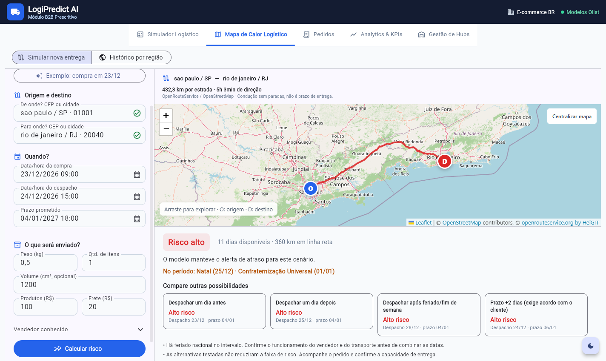

# Rotas rodoviárias no planejamento

Em **Mapa → Simular**, selecionar origem e destino consulta automaticamente o
trajeto pelas estradas. A linha acompanha a geometria do OpenRouteService,
tanto no Leaflet do Web quanto no mapa nativo Android. O cabeçalho informa
quilômetros por estrada e tempo estimado de direção.



A primeira aba continua passando pelos hubs selecionados. O planejamento de
uma compra futura consulta diretamente origem e destino, sem exigir um hub.

## Configuração

O backend usa Node.js 22 e lê opcionalmente `back/.env` ao iniciar. Copie
`back/.env.example` para `back/.env` e preencha:

```dotenv
OPENROUTE_API_KEY=sua_chave
```

A variável pode ser definida diretamente no ambiente do servidor. Ela tem
prioridade sobre o arquivo local. Reinicie o Node.js depois de configurar.
O backend consulta `https://api.heigit.org/openrouteservice/v2/directions/driving-car/geojson`.
O endereço antigo `api.openrouteservice.org` foi desligado pela HeiGIT em
24/11/2026 e responde HTTP 410; as mesmas chaves funcionam no novo endereço.
Se o provedor mudar de novo, defina `OPENROUTE_DIRECTIONS_URL` no servidor.

O arquivo `.env` fica fora do Git; a chave é enviada ao provedor pelo cabeçalho
`Authorization` e não acompanha respostas, URLs do mapa, código Web ou APK.

## Consulta da rota

```http
POST /api/v1/map/route
Content-Type: application/json
```

```json
{
  "origin": { "latitude": -23.55, "longitude": -46.63 },
  "destination": { "latitude": -22.90, "longitude": -43.17 }
}
```

A resposta contém `data.source`, `data.profile`, `data.distance_km`,
`data.duration_seconds` e `data.geometry`. A geometria é um `LineString`
GeoJSON, com pares na ordem **longitude, latitude**.

O serviço valida os pontos, usa timeout de 10 segundos, compartilha consultas
simultâneas idênticas e guarda até 128 rotas por até seis horas. Alterar datas,
peso ou valores não faz outra consulta de estrada. Uma nova origem ou destino
descarta a rota anterior, e respostas atrasadas não substituem a seleção atual.

## Relação com o modelo de risco

O modelo **564 + filtro** continua recebendo a distância geográfica e os
atributos usados no treinamento. A distância rodoviária é uma informação
adicional de planejamento. Os pesos, cortes, dados históricos e resultados
preservados não são alterados por esta integração.

O tempo da rota é uma estimativa de condução no perfil `driving-car`.
Não representa prazo de entrega, pois coleta, separação, paradas e operação
da transportadora ficam fora desse cálculo. As posições de CEP são aproximadas.

Se o provedor falhar, o mapa mantém os pontos e informa que o trajeto está
indisponível, com opção de tentar novamente. O cálculo de risco continua
disponível. Não é desenhada uma ligação reta como se fosse uma estrada.

## Testar na interface

1. Abra **Mapa → Simular** e use **Exemplo: compra em 23/12**.
2. Aguarde o trajeto e os quilômetros por estrada no cabeçalho do mapa.
3. Clique em **Calcular risco** para colorir a rota conforme a classificação.
4. Altere datas ou peso e calcule novamente: a previsão muda conforme as
   entradas, mantendo a rota entre os mesmos locais.
5. Selecione outro destino para buscar outro trajeto.

O teste integrado Web usa ChromeDriver compatível com o Chrome instalado,
os serviços locais ligados e uma chave configurada no backend:

```powershell
flutter drive --driver=test_driver/road_web_driver.dart --target=integration_test/road_map_web_test.dart -d web-server --browser-name=chrome --headless --dart-define=API_BASE_URL=http://127.0.0.1:3001
```

As capturas ficam em `flutter_app/build/reports/roads-web`. O teste verifica
a geometria com mais de dois pontos, a previsão real e a alternância para o
histórico, sem importar ou alterar pedidos operacionais.

No Android, instale a versão **1.0.1** do APK sobre a anterior. O endereço do
servidor salvo no aparelho é preservado na atualização.

Referências: [Directions / GeoJSON](https://giscience.github.io/openrouteservice/api-reference/endpoints/directions/requests-and-return-types),
[exemplos oficiais da API](https://playground.heigit.org/) e
[variáveis locais do Node.js](https://nodejs.org/download/release/latest-jod/docs/api/process.html#processloadenvfilepath).
