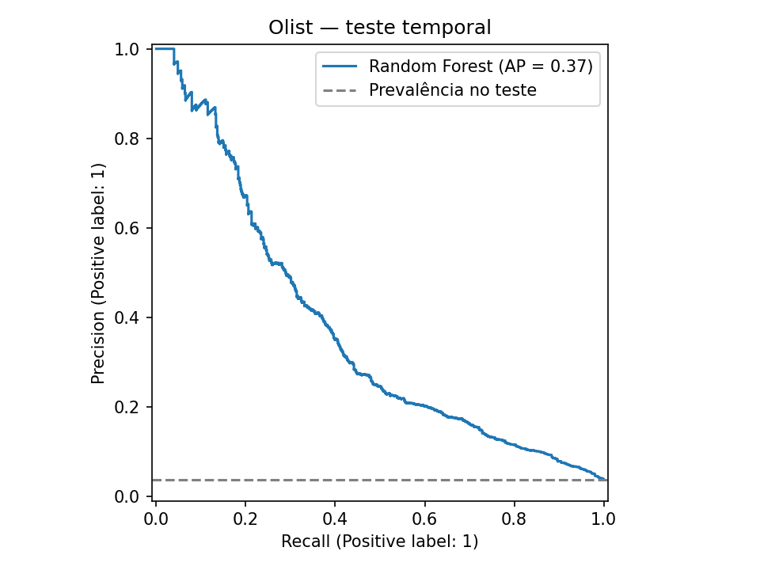
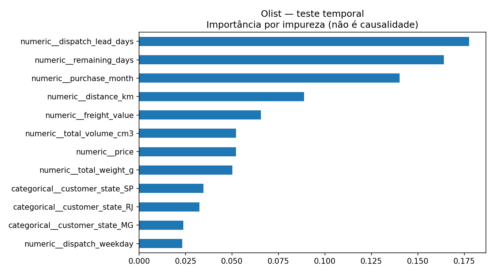

# Relatório de treinamento

Fonte: **olist**. Modelo: `rf-olist-bc50859e0aa7`. Hash SHA-256: `bc50859e0aa786d37a8933b230732bf0196acfc4287d802186f7a78e47dbc3a6`.
Base histórica Olist; resultados não garantem desempenho em operações atuais.

Divisão por despacho: 60% / 20% / 20%, com remoção de rótulos ainda indisponíveis nos cortes.
Treino: 54761; validação: 17445; teste: 19258; removidos nos cortes: 4817.
Limiar selecionado somente na validação: 0.39. O artefato mantém o modelo avaliado, sem retreino no teste.

| Métrica de teste | Random Forest | Baseline majoritária |
| --- | ---: | ---: |
| accuracy | 0.8029 | 0.9634 |
| precision | 0.1284 | 0.0000 |
| recall | 0.7585 | 0.0000 |
| f1 | 0.2196 | 0.0000 |
| average_precision | 0.3692 | 0.0366 |
| roc_auc | 0.8667 | 0.5000 |
| brier_score | 0.1018 | 0.0354 |

Probabilidade não calibrada; limiar acadêmico por F1 ainda requer validação do custo dos erros.
AP significa Average Precision, não a integral trapezoidal da curva PR.
Matriz: linhas = classes reais; colunas = previstas; ordem = [no prazo, atraso].

